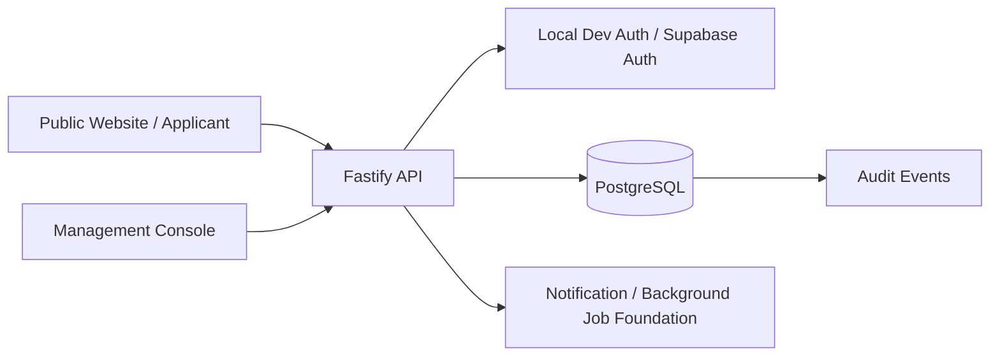

# Startup Jathara Management Platform

**Zeny2Labs · M1 implementation snapshot · Review before production use**

The Startup Jathara Management Platform is being built to support **Startup Jathara @ Dandakaranya**, organised by GIET University in association with the International Startup Foundation (ISF), at GIET University, Gunupur, Odisha. The event is scheduled for **18–20 December 2026**, with a pre-event day on **17 December 2026**.

This repository contains the first working vertical slice: **startup registration → Management review → selection decision release → applicant status**. It is an implementation baseline, not a complete delivery of every feature described in the PRD.

> **Not production-ready.** Real Supabase authentication, final application fields, approved privacy text, production hosting and security review are still required. Do not enter real participant data or deploy publicly until the open launch blockers in `docs/EXECUTION_PLAN.md` are resolved.

## Project status

### Implemented in this snapshot

- Public Next.js website for 2026/2027 startup applications.
- Management console for reviewing applications, drafting decisions and releasing results.
- Fastify API and PostgreSQL-backed registration and selection workflows.
- Separate application status for 2026 and 2027; registering for both creates independent applications.
- Server-side enforcement of the configured registration deadline.
- Database-backed duplicate prevention for a startup and event edition.
- Management-only selection decisions and suppression of unreleased decisions from applicant views.
- Edition access granted as part of a released selection decision.
- Shared Zod contracts, a typed API client, SQL migrations, seed data and CI workflow.
- API integration tests and a browser end-to-end smoke test.

The initial implementation report records 47 API integration tests against PostgreSQL and a browser flow. **Rerun the commands in this README against your own environment and review the results before relying on that report.**

### Planned / not yet complete

- Admin import and account-management workflows.
- Production identity configuration and complete account-activation lifecycle.
- AI-assisted startup ranking and criteria management.
- Jury scoring UI and workflow.
- Random volunteer assignment and reassignment UI.
- Event content, notices and push notifications.
- Native Android/iOS app (Expo).
- AI Help Desk, WhatsApp integration, customer-support workflows and emergency escalation.
- Production deployment, load/security testing and disaster-recovery validation.

See the [Technical Execution Plan](docs/EXECUTION_PLAN.md) for dependencies, acceptance criteria, blockers and milestone status.

## Event rules represented in the implementation

- Applicants may apply for **2026 only**, **2027 only**, or **both**.
- Each year's application status is independent. A 2026 rejection must not automatically reject a 2027 application.
- A 2027-only applicant must not receive 2026 event access.
- An application for the same startup and edition may be submitted only once.
- AI ranking (planned) is advisory. **Management makes every final startup selection/rejection decision.**
- Each volunteer will eventually be assigned to exactly one target: **one startup OR one jury member**, never both. Volunteer assignment is not yet implemented as a complete user workflow.

The 2026 registration deadline is **5 November 2026**. The exact cutoff time and timezone remain a stakeholder decision; the current `23:59:59 IST` value is provisional and must not be treated as approved policy.

## Architecture



The API is a TypeScript modular monolith. PostgreSQL migrations are the schema source of truth. Authentication identifies the caller; application-level permissions and record relationships determine what the caller may do. The planned ranking and Help Desk services must remain separate, and AI components must never receive final selection authority.

### Repository layout

```text
apps/
  api/                  Fastify API, domain modules, SQL access and tests
  web/                  Public website and applicant pages (Next.js)
  console/              Management console (Next.js)
  mobile/               Planned Expo application; not implemented in M1
packages/
  contracts/            Shared Zod schemas and TypeScript types
  client/               Typed API client
  web-session/          Browser session and auth adapter
db/migrations/           Forward-only SQL migrations
docs/EXECUTION_PLAN.md   Stack, API boundaries, schema, backlog, risks and TBDs
scripts/                 Local database and browser-test helpers
.github/workflows/       Continuous integration workflow
```

## Technology stack

| Layer | Current direction |
|---|---|
| Language | TypeScript; Node.js 22 or newer |
| Package manager | pnpm 10 (workspace monorepo) |
| API | Fastify 5, Zod validation, SQL-first migrations |
| Database | PostgreSQL 16+ |
| Website and console | Next.js 16 / React 19 |
| Mobile (planned) | Expo / React Native |
| Production identity (planned) | Supabase Auth OTP; API-enforced authorisation |
| Background jobs (planned) | pg-boss with PostgreSQL |
| Proposed hosting | Supabase in Mumbai, Cloud Run in Mumbai, Vercel in Mumbai; budget/account ownership TBD |

Hosting choices are recommendations, not confirmed commercial or deployment commitments.

## Getting started

### Prerequisites

- Node.js 22+
- pnpm 10.x
- PostgreSQL 16+, or Docker with Docker Compose
- Python 3 for the optional Playwright smoke-test script

### 1. Install dependencies

```bash
pnpm install
cp .env.example .env
```

The default local configuration uses `AUTH_MODE=dev` and does not require external accounts. **Development authentication is for local development only. Never use it in staging or production.**

### 2. Start PostgreSQL

Use the included helper if PostgreSQL server utilities are installed:

```bash
pnpm db:start
```

Alternatively, start the Compose database:

```bash
docker compose up -d
```

Make sure `DATABASE_URL` in `.env` points to the running database. The helper's default URL uses port `54329`; adjust it if you use a different PostgreSQL instance.

### 3. Apply migrations and seed development accounts

```bash
pnpm db:migrate
pnpm db:seed
```

The development seed creates these local-only accounts:

| Role | Development account |
|---|---|
| Management | `manager@dev.local` |
| Admin (without Management permission) | `admin@dev.local` |
| Customer Support | `support@dev.local` |

These are not production credentials. The seed script refuses to run when `NODE_ENV=production`.

### 4. Run the API, website and console

Open three terminals from the repository root:

```bash
pnpm dev:api
```

```bash
pnpm dev:web
```

```bash
pnpm dev:console
```

Default local URLs:

- Website: <http://localhost:3000>
- Management console: <http://localhost:3001>
- API: <http://localhost:4000>

Use the development accounts above to exercise the local workflow. Local development auth bypasses a real identity provider; never expose these services publicly.

## Tests and builds

```bash
pnpm -r typecheck
pnpm --filter @sj/api test
pnpm -r build
```

API integration tests require PostgreSQL. The test harness uses `TEST_DATABASE_URL` if configured; see `docs/EXECUTION_PLAN.md` for the current test setup.

For browser end-to-end verification, start the API, website and console, install Playwright and Chromium, then run:

```bash
python3 -m pip install playwright
python3 -m playwright install chromium
python3 scripts/e2e_smoke.py /tmp/startup-jathara-shots
```

CI is configured in [`.github/workflows/ci.yml`](.github/workflows/ci.yml) to install dependencies, typecheck, run API integration tests against PostgreSQL and build the workspaces.

## Configuration

Copy `.env.example` to `.env` and configure only the variables required by your environment. Important settings include:

| Variable | Purpose |
|---|---|
| `DATABASE_URL` | PostgreSQL connection string |
| `PORT` | API listening port (default `4000`) |
| `AUTH_MODE` | `dev` locally; `supabase` only after real provider setup |
| `DEV_AUTH_SECRET` | Local-only development signing secret; use a unique secret locally |
| `SUPABASE_URL` | Supabase project URL for provider/JWKS verification |
| `REQUIRE_STAFF_MFA` | Require MFA for privileged staff in supported production configuration |
| `CORS_ORIGINS` | Explicit allowlist of trusted web origins |
| `NEXT_PUBLIC_API_URL` | API URL used by website and console |
| `NEXT_PUBLIC_AUTH_MODE` | Client auth mode matching the target environment |
| `NEXT_PUBLIC_SUPABASE_URL` | Supabase URL for browser sign-in, when configured |
| `NEXT_PUBLIC_SUPABASE_ANON_KEY` | Supabase publishable/anon key; never put a service-role key here |

Never commit `.env`, OTPs, tokens, Supabase service-role keys, cloud credentials or participant spreadsheets. Only `.env.example` belongs in source control.

## Security and data handling

- Keep this repository **private until stakeholders approve visibility**; it contains unfinished application code and operational planning information.
- Do not use the unrelated personal Supabase project for this application. Create project-owned staging and production environments after ownership and budget approval.
- Before production: verify OTP claims and account linking against real Supabase configuration, enforce account activation server-side, configure staff MFA, approve the privacy notice, run security tests and review role/record-level access.
- Keep staging data synthetic. Do not copy production participant records to staging.
- Application form fields, privacy/retention policy, sign-in identifier, deadline cutoff and deployment ownership are still decision items.
- No production deployment or app-store release is implied by this repository snapshot.

See [docs/EXECUTION_PLAN.md](docs/EXECUTION_PLAN.md) for P0 launch blockers and the acceptance checklist. Report security concerns privately to the repository owners; do not include secrets or personal data in issues.

## Roadmap

1. **M1 — Registration vertical slice:** website registration, API, PostgreSQL, Management decision workflow and applicant status.
2. **M2 — Administration:** secure account activation, bulk imports, role management and initial reports.
3. **M3 — AI ranking:** approved criteria, isolated ranking worker, explanations and human-controlled decisions.
4. **M4 — Jury and volunteers:** jury scoring and random one-to-one volunteer assignment.
5. **M5 — Event information:** schedules, documents, notices and push notifications.
6. **M6 — Mobile:** Android/iOS app and role-specific screens.
7. **M7 — Help Desk and support:** in-app/WhatsApp Help Desk, ticketing and emergency workflow.
8. **M8 — Production readiness:** security review, load tests, backups/restore drill, monitoring and release.

Phase targets depend on stakeholder decisions, team capacity, vendor onboarding and app-store review. See the execution plan for current dependencies and schedule risks.

## Documentation

- [Technical Execution Plan](docs/EXECUTION_PLAN.md) — decisions, data model, APIs, security practices, milestones, backlog and open items.
- **Product requirements:** `Startup_Jathara_PRD_v1.0` is the source-of-truth requirements baseline and is maintained separately from this initial code archive.

## Publishing this repository to GitHub

Recommended initial visibility: **Private**. The repository creation and initial push helper is available at [`scripts/publish-to-github.sh`](scripts/publish-to-github.sh). Requirements: Git, GitHub CLI (`gh`) and an authenticated GitHub CLI session (`gh auth login`). Review the files and ensure no secrets or real participant data are present before pushing.

## License

No open-source licence has been selected. All rights and usage permissions remain subject to the rights holder's decision; do not assume this code is licensed for redistribution or commercial reuse.
