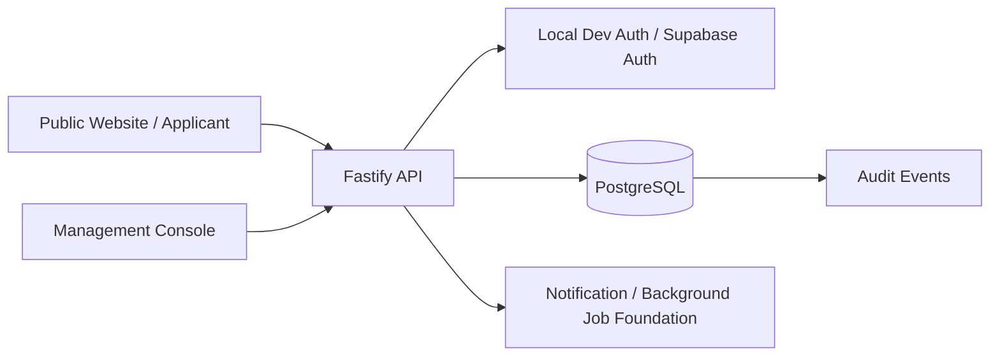

# Startup Jathara Management Platform

**Zeny2Labs · Phases 1–4 implementation snapshot · Review before production use**

The Startup Jathara Management Platform is being built to support **Startup Jathara @ Dandakaranya**, organised by GIET University in association with the International Startup Foundation (ISF), at GIET University, Gunupur, Odisha. The event is scheduled for **18–20 December 2026**, with a pre-event day on **17 December 2026**.

This repository contains **Phases 1–4 of 10**:

- the registration vertical slice: **startup registration → Management review → selection decision release → applicant status**;
- Admin bulk import, account activation and role administration;
- the Android/iOS app foundation.

It is an implementation baseline, not a complete delivery of every feature described in the PRD.

The architecture is locked in [`docs/ARCHITECTURE.md`](docs/ARCHITECTURE.md) (ADR-001). The 10 delivery phases are listed in [`docs/PHASES.md`](docs/PHASES.md).

> **Not production-ready.** Real Supabase authentication (including the server-side `SUPABASE_SERVICE_ROLE_KEY` identity check), final application fields, approved privacy text, production hosting and security review are still required. Do not enter real participant data or deploy publicly until [`docs/LAUNCH_CHECKLIST.md`](docs/LAUNCH_CHECKLIST.md) is signed off. **The API enforces this:** with `NODE_ENV=production` it refuses to start until Supabase sign-in, staff MFA, HTTPS-only origins, an approved (non-draft) privacy notice, a real ranking model (not the development stub), no log-only message providers and `LAUNCH_APPROVED=true` are all in place.

## Project status

### Implemented in this snapshot

- Public Next.js website for 2026/2027 startup applications.
- Management console for reviewing applications, drafting decisions and releasing results.
- Fastify API and PostgreSQL-backed registration and selection workflows.
- Separate application status for 2026 and 2027; registering for both creates independent applications.
- Server-side enforcement of the configured registration deadline.
- Database-backed duplicate prevention for a startup and event edition.
- Management-only selection decisions and suppression of unreleased decisions from applicant views.
- Edition access granted as part of a released selection decision.
- Shared Zod contracts, a typed API client, SQL migrations, seed data and CI workflow.
- API integration tests and a browser end-to-end smoke test.
- **Security hardening** (see [`docs/SECURITY_FIX_2026-10-15.md`](docs/SECURITY_FIX_2026-10-15.md)):
  - email/phone verification is read from the authoritative Supabase user record, never from editable token claims;
  - pre-created accounts are linked to a sign-in only through a verified email or phone (fail-closed);
  - account activation status is enforced server-side for all roles.
- **Phase 3, Admin:**
  - CSV import of predefined startups, jury, volunteers and delegates, run as validate → preview → commit;
  - errors are reported by row and field; duplicates and shared mobile numbers are detected; password columns are rejected;
  - imported accounts start as pending activation;
  - activation codes are single-use and time-limited, and only their hash is stored;
  - Admins can grant and revoke roles, deactivate and reactivate accounts; nobody can change their own roles or status;
  - `GET /v1/me`, and a website activation page.
- **Phase 4, mobile:** an Expo (SDK 57) app for Android and iOS on the same API, with sign-in, activation, a role-aware home screen, startup registration, per-year application status and messages.
- **Sign-in by email or mobile number** (one-time code by email or SMS) on the website and the app. Decision TBD-12 ([`docs/DECISIONS.md`](docs/DECISIONS.md)): both channels; deployed environments offer email only until the DLT-registered SMS sender is live.
- **Mobile session in the device keychain/keystore**, never in plain storage.
- **Staff MFA policy:** mandatory in production. Admin, Management and Support complete an authenticator-app step before any privileged action.
- **Import hardening:** malformed rows (shifted columns, control characters, unreadable text, oversized cells, spreadsheet-formula prefixes) are rejected row by row.
- **Decisions on every open TBD** (15 Oct 2026, [`docs/DECISIONS.md`](docs/DECISIONS.md)), most awaiting organiser, Management, legal or budget approval. Built from them:
  - the application form's six questions are edition configuration (migration 0007), served to the website and app and frozen once applications exist (TBD-39);
  - applicants confirm they are 18 or older (TBD-45);
  - releasing decisions above the selection limit needs explicit, audited confirmation (TBD-19).
- **Phase 5, AI ranking and selection** (details in [`docs/PHASES.md`](docs/PHASES.md)):
  - versioned criteria sets that Management creates and approves; draft v1 (TBD-01) ships unapproved;
  - ranking runs over a whole edition after its registration closes (TBD-42), scored by a model adapter (Google Vertex AI, or a development stub that is **not an AI**), validated, weighted and ranked outside the model; incomplete or invalid results go to manual review; steering attempts are flagged;
  - the ranking worker runs as a database role that cannot write decisions or read contact data (AT-11);
  - overrides of the ranking need a written reason (TBD-18); released decisions change only through a two-person correction (TBD-37); applicants can withdraw a year's application;
  - result, correction and activation messages by email or SMS through an outbox with per-message status (TBD-13, TBD-14);
  - `pnpm --filter @sj/api ranking:eval` evaluates a model on synthetic applications.
- **Phase 6, jury evaluation and volunteer assignment** (details in [`docs/PHASES.md`](docs/PHASES.md)):
  - Management versions and approves the jury rubric (draft v1 ships unapproved, TBD-43), assigns jurors to startups, schedules pitches and marks the startup currently pitching;
  - jurors (app) see only their assigned startups and the current pitch, without contact details or AI data; they save drafts and submit scores, which are then locked; Management reviews them per rubric version, with no winner, and can reopen one with a reason;
  - jury scores are kept apart from AI ranking and selection: the ranking worker has no access to jury tables, and scoring changes no application, ranking or decision;
  - random, reproducible one-to-one volunteer assignment as a draft for Management review; shortages are listed as unassigned targets, never doubled up; reassignment and ending keep a full history (who, when, why); concurrent requests cannot double-assign;
  - volunteers and targets see each other's name and mobile number in the app (TBD-49) and are told through in-app notices and the email/SMS outbox (TBD-48).

The latest verification recorded the following, and GitHub Actions runs the automated part on every push:

- 346 API tests (integration tests against PostgreSQL, plus unit tests);
- 8 mobile unit tests;
- eight browser flows: website + Management, Admin import + activation, phone sign-in, open-redirect protection, the mobile app at phone size, staff MFA, AI ranking through to a two-person correction, and jury scoring plus volunteer assignment in the console and the app. **Rerun the commands in this README against your own environment and review the results before relying on that report.**

### Planned / not yet complete

- Production identity configuration (Supabase production).
- Live provider accounts: Vertex AI for ranking, Amazon SES for email, MSG91 with DLT templates for SMS (TBD-35). The adapters are built and tested against recorded request formats, not yet against live accounts. Until a provider is configured, messages stay queued and activation codes are handed over manually.
- Organisers' sign-off of import column set v1 on a real sample file (TBD-41).
- Sign-out on the first app launch after a reinstall (OD-02), required before store submission.
- Event content, notices and push notifications.
- Event features in the mobile app (schedule, venues, notices, push notifications, Help Desk), and app-store builds (needs organisation-owned Apple/Google accounts, TBD-36).
- AI Help Desk, WhatsApp integration, customer-support workflows and emergency escalation.
- Production deployment, load/security testing and disaster-recovery validation.

See the [Technical Execution Plan](docs/EXECUTION_PLAN.md) for dependencies, acceptance criteria, blockers and milestone status.

## Event rules represented in the implementation

- Applicants may apply for **2026 only**, **2027 only**, or **both**.
- Each year's application status is independent. A 2026 rejection must not automatically reject a 2027 application.
- A 2027-only applicant must not receive 2026 event access.
- An application for the same startup and edition may be submitted only once.
- AI ranking (planned) is advisory. **Management makes every final startup selection/rejection decision.**
- Each volunteer will eventually be assigned to exactly one target: **one startup OR one jury member**, never both. Volunteer assignment is not yet implemented as a complete user workflow.

The 2026 registration deadline is **5 November 2026**. The recommended cut-off is `23:59:59 IST` on that day (TBD-11, [`docs/DECISIONS.md`](docs/DECISIONS.md)); it awaits the organisers' written confirmation, and the website shows "time to be confirmed" until `closes_at_confirmed` is set.

## Architecture



The API is a TypeScript modular monolith. PostgreSQL migrations are the schema source of truth. Authentication identifies the caller; application-level permissions and record relationships determine what the caller may do. The planned ranking and Help Desk services must remain separate, and AI components must never receive final selection authority.

### Repository layout

```text
apps/
  api/                  Fastify API, domain modules, SQL access and tests
  web/                  Public website and applicant pages (Next.js)
  console/              Admin / Management console (Next.js); sections shown by permission
  mobile/               Android + iOS app (Expo SDK 57, Expo Router)
packages/
  contracts/            Shared Zod schemas and TypeScript types
  client/               Typed API client
  web-session/          Browser session and auth adapter
db/migrations/           Forward-only SQL migrations
docs/ARCHITECTURE.md     ADR-001: the locked architecture
docs/PHASES.md           The 10 delivery phases and their status
docs/EXECUTION_PLAN.md   Stack, API boundaries, schema, backlog and risks
docs/DECISIONS.md        Decision register: every TBD resolved, with the approvals still needed
scripts/                 Local database and browser-test helpers
.github/workflows/       Continuous integration workflow
```

## Technology stack

| Layer | Current direction |
|---|---|
| Language | TypeScript; Node.js 22 or newer |
| Package manager | pnpm 10 (workspace monorepo) |
| API | Fastify 5, Zod validation, SQL-first migrations |
| Database | PostgreSQL 16+ |
| Website and console | Next.js 16 / React 19 |
| Mobile | Expo SDK 57 / React Native 0.86, Expo Router; one app for Android and iOS |
| Production identity (planned) | Supabase Auth OTP; API-enforced authorisation |
| Background jobs (planned) | pg-boss with PostgreSQL |
| Proposed hosting | Supabase in Mumbai, Cloud Run in Mumbai, Vercel in Mumbai; budget/account ownership TBD |

Hosting choices are recommendations, not confirmed commercial or deployment commitments.

## Getting started

### Prerequisites

- Node.js 22+
- pnpm 10.x
- PostgreSQL 16+, or Docker with Docker Compose
- Python 3 for the optional Playwright smoke-test script

### 1. Install dependencies

```bash
pnpm install
cp .env.example .env
```

The default local configuration uses `AUTH_MODE=dev` and does not require external accounts. **Development authentication is for local development only. Never use it in staging or production.**

### 2. Start PostgreSQL

Use the included helper if PostgreSQL server utilities are installed:

```bash
pnpm db:start
```

Alternatively, start the Compose database:

```bash
docker compose up -d
```

Make sure `DATABASE_URL` in `.env` points to the running database. The helper's default URL uses port `54329`; adjust it if you use a different PostgreSQL instance.

### 3. Apply migrations and seed development accounts

```bash
pnpm db:migrate
pnpm db:seed
```

The development seed creates these local-only accounts:

| Role | Development account |
|---|---|
| Management | `manager@dev.local` |
| Admin (without Management permission) | `admin@dev.local` |
| Customer Support | `support@dev.local` |

These are not production credentials. The seed script refuses to run when `NODE_ENV=production`.

### 4. Run the API, website and console

Open three terminals from the repository root:

```bash
pnpm dev:api
```

```bash
pnpm dev:web
```

```bash
pnpm dev:console
```

Optional, for the mobile app:

```bash
pnpm dev:mobile
```

Default local URLs:

- Website: <http://localhost:3000>
- Console: <http://localhost:3001> (`manager@dev.local` and `manager2@dev.local` see Applications and AI ranking; `admin@dev.local` sees Accounts and Imports)
- API: <http://localhost:4000>

### 5. Run the mobile app on a phone (optional)

1. Install **Expo Go** (Play Store / App Store) on a phone that is on the same Wi-Fi as your computer.
2. Run `pnpm dev:mobile` and scan the QR code.
3. In development the app calls the API on the computer that is running Expo, on port 4000. If Windows Firewall asks, allow Node.js on private networks. You can also set `EXPO_PUBLIC_API_URL=http://<computer-ip>:4000` yourself.
4. To act as an imported participant, import them in the console under **Imports**, issue a code under **Accounts**, and enter that code in the app.

Use the development accounts above to exercise the local workflow. Local development auth bypasses a real identity provider; never expose these services publicly.

## Tests and builds

```bash
pnpm -r typecheck
pnpm --filter @sj/api test
pnpm -r build
```

API integration tests require PostgreSQL. The test harness uses `TEST_DATABASE_URL` if configured; see `docs/EXECUTION_PLAN.md` for the current test setup.

For browser end-to-end verification, start the API, website and console, install Playwright and Chromium, then run:

```bash
python3 -m pip install playwright
python3 -m playwright install chromium
python3 scripts/e2e_smoke.py /tmp/startup-jathara-shots   # website + Management
python3 scripts/e2e_admin.py /tmp/startup-jathara-shots   # Admin import → activation
python3 scripts/e2e_phone.py /tmp/startup-jathara-shots   # sign-in by mobile number
python3 scripts/e2e_redirect.py                           # crafted ?next= links stay on-site
# staff MFA: restart the API with REQUIRE_STAFF_MFA=true, then
python3 scripts/e2e_mfa.py /tmp/startup-jathara-shots
# mobile: serve the web build on :8081 and add http://localhost:8081 to CORS_ORIGINS, then
pnpm --filter @sj/mobile export:web && python3 scripts/e2e_mobile.py /tmp/startup-jathara-shots
# AI ranking (Phase 5) runs after the 2026 deadline, so use a fresh database, the synthetic cohort and a pinned clock:
SEED_DEMO_APPLICATIONS=1 pnpm db:seed
DEV_NOW=2026-11-06T10:00:00+05:30 RANKING_PROVIDER=stub NOTIFY_EMAIL_PROVIDER=log pnpm dev:api
python3 scripts/e2e_ranking.py /tmp/startup-jathara-shots
# Jury and volunteers (Phase 6): a freshly seeded database (it checks a volunteer shortage), the console and the mobile web build
pnpm db:seed && pnpm dev:api
python3 scripts/e2e_jury_volunteers.py /tmp/startup-jathara-shots
```

Model evaluation on synthetic applications (no database, no real data). With the stub it checks the harness only:

```bash
RANKING_PROVIDER=vertex RANKING_VERTEX_PROJECT=<project> RANKING_VERTEX_MODEL=<model> pnpm --filter @sj/api ranking:eval
```

Background work (ranking runs, the email/SMS outbox) runs inside the API process by default (`RUN_WORKERS=true`). On hosts that throttle CPU between requests, run `pnpm --filter @sj/api start:worker` as its own service and set `RUN_WORKERS=false` on the API.

CI is configured in [`.github/workflows/ci.yml`](.github/workflows/ci.yml) to install dependencies, typecheck, run API integration tests against PostgreSQL and build the workspaces.

## Configuration

Copy `.env.example` to `.env` and configure only the variables required by your environment. Important settings include:

| Variable | Purpose |
|---|---|
| `DATABASE_URL` | PostgreSQL connection string |
| `PORT` | API listening port (default `4000`) |
| `AUTH_MODE` | `dev` locally; `supabase` only after real provider setup |
| `DEV_AUTH_SECRET` | Local-only development signing secret; use a unique secret locally |
| `SUPABASE_URL` | Supabase project URL for provider/JWKS verification |
| `SUPABASE_SERVICE_ROLE_KEY` | **API only, server-side secret.** Reads the authoritative user record to confirm email/phone verification. Never a `NEXT_PUBLIC_*` or `EXPO_PUBLIC_*` value |
| `ACTIVATION_TTL_HOURS` | Validity of activation codes (default 72, as recommended in TBD-13; awaiting organiser approval) |
| `REQUIRE_STAFF_MFA` | Require MFA (aal2) for Admin, Management and Support. On by default in production and cannot be turned off there. Off locally unless set to `true` |
| `LAUNCH_APPROVED` | Production start gate. Set to `true` only after `docs/LAUNCH_CHECKLIST.md` is signed off |
| `RUN_WORKERS` | Run ranking and outbox workers inside the API process (default `true`) |
| `RANKING_PROVIDER` | `stub` (development only, **not an AI**, refused in production) or `vertex` |
| `RANKING_VERTEX_PROJECT`, `RANKING_VERTEX_LOCATION`, `RANKING_VERTEX_MODEL` | Vertex AI for ranking (location default `asia-south1`; the model is chosen by `ranking:eval`, TBD-35) |
| `RANKING_VERTEX_SERVICE_ACCOUNT` | A service account used only for ranking, impersonated by the runtime identity (FR-RNK-12) |
| `NOTIFY_EMAIL_PROVIDER`, `SMTP_HOST`, `SMTP_PORT`, `SMTP_USER`, `SMTP_PASS`, `NOTIFY_EMAIL_FROM` | Email outbox: `none` (messages stay queued), `log` (development only) or `smtp` (Amazon SES) |
| `NOTIFY_SMS_PROVIDER`, `MSG91_AUTH_KEY`, `MSG91_TEMPLATE_RESULT`, `MSG91_TEMPLATE_CORRECTION`, `MSG91_TEMPLATE_ACTIVATION`, `MSG91_TEMPLATE_ASSIGNMENT` (volunteer assignments, TBD-48) | SMS outbox: `none`, `log` (development only) or `msg91` with DLT-registered template ids |
| `PUBLIC_WEB_URL` | Website address used in result messages |
| `DEV_NOW` | Development only: pins the API clock (refused in production and outside `AUTH_MODE=dev`) |
| `NEXT_PUBLIC_SIGNIN_METHODS`, `EXPO_PUBLIC_SIGNIN_METHODS` | Sign-in channels: `email`, `phone` or `email,phone`. Unset allows both (development). Deployed environments set `email` until the DLT-registered SMS sender is live, then `email,phone` (TBD-12) |
| `CORS_ORIGINS` | Explicit allowlist of trusted web origins |
| `NEXT_PUBLIC_API_URL` | API URL used by website and console |
| `NEXT_PUBLIC_AUTH_MODE` | Client auth mode matching the target environment |
| `NEXT_PUBLIC_SUPABASE_URL` | Supabase URL for browser sign-in, when configured |
| `NEXT_PUBLIC_SUPABASE_ANON_KEY` | Supabase publishable/anon key; never put a service-role key here |
| `EXPO_PUBLIC_API_URL`, `EXPO_PUBLIC_AUTH_MODE`, `EXPO_PUBLIC_SUPABASE_*` | Mobile app settings, inlined at build time (public values only) |

Never commit `.env`, OTPs, tokens, Supabase service-role keys, cloud credentials or participant spreadsheets. Only `.env.example` belongs in source control.

## Security and data handling

- Keep this repository **private until stakeholders approve visibility**; it contains unfinished application code and operational planning information.
- Do not use the unrelated personal Supabase project for this application. Create project-owned staging and production environments after ownership and budget approval.
- Before production: verify OTP claims and account linking against real Supabase configuration (implemented and tested against Supabase-shaped data, not yet against a live project), approve the privacy notice, run security tests and review role/record-level access. The full list, with the items the API enforces, is in [`docs/LAUNCH_CHECKLIST.md`](docs/LAUNCH_CHECKLIST.md).
- Keep staging data synthetic. Do not copy production participant records to staging.
- Application form fields, privacy/retention policy, sign-in identifier, deadline cutoff and deployment ownership are still decision items.
- No production deployment or app-store release is implied by this repository snapshot.

See [docs/EXECUTION_PLAN.md](docs/EXECUTION_PLAN.md) for P0 launch blockers and the acceptance checklist. Report security concerns privately to the repository owners; do not include secrets or personal data in issues.

## Roadmap

1. **M1 — Registration vertical slice:** website registration, API, PostgreSQL, Management decision workflow and applicant status.
2. **M2 — Administration:** secure account activation, bulk imports, role management and initial reports.
3. **M3 — AI ranking:** approved criteria, isolated ranking worker, explanations and human-controlled decisions.
4. **M4 — Jury and volunteers:** jury scoring and random one-to-one volunteer assignment.
5. **M5 — Event information:** schedules, documents, notices and push notifications.
6. **M6 — Mobile:** Android/iOS app and role-specific screens.
7. **M7 — Help Desk and support:** in-app/WhatsApp Help Desk, ticketing and emergency workflow.
8. **M8 — Production readiness:** security review, load tests, backups/restore drill, monitoring and release.

The current 10-phase breakdown, with Phases 1–4 done, is in [`docs/PHASES.md`](docs/PHASES.md). Phase targets depend on stakeholder decisions, team capacity, vendor onboarding and app-store review. See the execution plan for current dependencies and schedule risks.

## Documentation

- [Architecture (ADR-001)](docs/ARCHITECTURE.md) — the locked architecture.
- [Delivery phases](docs/PHASES.md) — the 10 phases and their status.
- [Technical Execution Plan](docs/EXECUTION_PLAN.md) — stack, data model, APIs, security practices, milestones and backlog.
- [Decision register](docs/DECISIONS.md) — the recommended decision for every TBD, its rationale and who must approve it.
- [Privacy notice draft](docs/PRIVACY_NOTICE_DRAFT.md) — for legal review (TBD-32); not approved.
- [Security fix report](docs/SECURITY_FIX_2026-10-15.md) — identity verification, account linking and activation enforcement, reconciled to the current state (§8).
- [Device test protocol](docs/DEVICE_TEST_PROTOCOL.md) — real-phone checks for sessions, refresh, sign-out and MFA (with `pnpm --filter @sj/api staging:verify` for the live Supabase server side).
- [Launch checklist](docs/LAUNCH_CHECKLIST.md) — what must be signed off before production; the API refuses to start in production until then.
- **Product requirements:** `Startup_Jathara_PRD_v1.0` is the source-of-truth requirements baseline and is maintained separately from this initial code archive.

## Publishing this repository to GitHub

Recommended initial visibility: **Private**. The repository creation and initial push helper is available at [`scripts/publish-to-github.sh`](scripts/publish-to-github.sh). Requirements: Git, GitHub CLI (`gh`) and an authenticated GitHub CLI session (`gh auth login`). Review the files and ensure no secrets or real participant data are present before pushing.

## License

No open-source licence has been selected. All rights and usage permissions remain subject to the rights holder's decision; do not assume this code is licensed for redistribution or commercial reuse.
